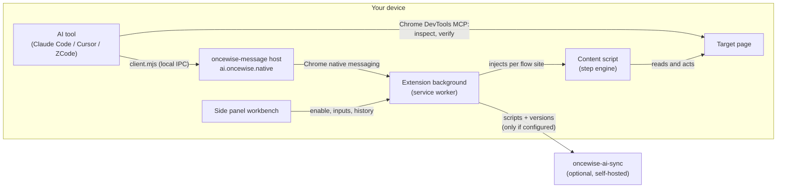

One repository holds four deployable pieces: a Chrome extension, an optional sync backend, the agent skills that glue an AI tool to the extension, and this documentation site. Everything is built around one position: the browser is the data master, and the only remote component is a sync server you choose to point at.



## Repository layout

```
extension/   Chrome MV3 extension (WXT + React)
backend/     oncewise-ai-sync (Rust/Axum + PostgreSQL)
skills/      Agent skills + the native-messaging programs (source of truth)
demo/        Playwright extension e2e (loads the real build output)
scripts/     Test and demo runners (Python, uv)
docs/        PRDs and user stories (the product's decision record)
docs-web/    This documentation site
```

`DESIGN.md` holds the visual spec; product constraints defer to `docs/`.

## Extension

WXT + React, four entrypoints:

- **background** — the service worker. Runtime messaging hub, flow store, business-instance claims (the duplicate-submit guard), and the native-messaging port.
- **content** — injected dynamically per the flow's site, never globally registered. Hosts the step engine that executes the constrained tree ([Flows](./flows)); when the last flow for an origin is deleted, the registration is removed.
- **sidepanel** — the workbench you see when clicking the toolbar icon: flow list, editor with inputs and enable controls, version history, the Optimize-with-AI grant, and the Sync tab.
- **import page** — the confirmation surface for AI deliveries, plus a compact flow list with enable/pause toggles.

`lib/` holds about 29 modules in three families: `flow-*` (schema, compiler, DOM driver, dry-run presentation), `import-*` (handover intake), and `sync-*` (API client, storage, Herald sign-in). Vitest unit tests mirror `lib/` file-for-file; story-level acceptance lives in the Playwright suite under `demo/e2e/extension/`, which loads the real build output against self-managed fixtures.

Two design calls worth knowing:

- **Constrained step trees instead of scripts.** A flow is data from a closed vocabulary with engine-enforced budgets. Nothing a flow carries can execute, which is what makes unattended runs on logged-in pages acceptable.
- **Local-first storage.** Flows, settings, inputs and the 10-version history live in `chrome.storage`. There is no account, no telemetry, and no server in the default loop.

## The local channel

`skills/oncewise-message/` ships the host (`host.mjs`) and the CLI (`client.mjs`). The AI tool writes a request to a local IPC endpoint; the host relays it to the extension over Chrome's native messaging; one JSON result comes back the same way. The host relays in memory and persists no flow data. The channel can validate, save and verify flows; it cannot enable, delete or roll back — those transitions exist only behind the extension UI, and the import page remains the place where you confirm deliveries.

## Backend

`oncewise-ai-sync` (Rust/Axum, sqlx migrations at startup, utoipa for the spec): spaces keyed by client-generated ID + key, scripts, immutable versions. Routes group into `auth`, `spaces`, `scripts`, `ops`; the whole surface is generated into the [OpenAPI reference](./openapi) and served at `/api/openapi.json`. The space model has no accounts; the deployment-level Herald gate is a separate layer that does not change space semantics ([Self-hosting](./self-hosting)).

On the client, `sync-*` modules implement the same surface: server URL and mode probe, spaces and versions, and the Herald OAuth flow (authorization window, silent renewal, epoch-guarded local session storage).

## Verification

All test and demo run instructions are maintained centrally in [`scripts/index.md`](https://github.com/timzaak/OnceWise/blob/main/scripts/index.md) — environment prerequisites, log locations, failure recovery. The repository's README keeps no duplicate commands. The demo environment (`uv run scripts/demo-start.py`) brings up the extension build, the backend, a Herald login dependency and a browser with the extension loaded, so the whole loop above can be exercised by hand.
