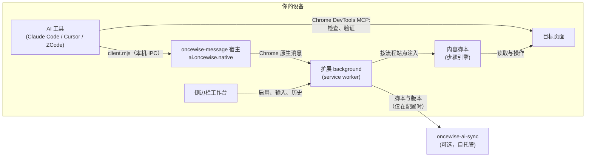

一个仓库装着四个可部署件：Chrome 扩展、可选的同步后端、把 AI 工具与扩展连起来的 agent skills，以及本文档站。一切都围绕同一个立场构建：浏览器是数据主体，唯一的远程组件是你自己选择指向的同步服务器。



## 仓库布局

```
extension/   Chrome MV3 扩展（WXT + React）
backend/     oncewise-ai-sync（Rust/Axum + PostgreSQL）
skills/      Agent skills 与本机消息程序（唯一源）
demo/        Playwright 扩展 e2e（加载真实构建产物）
scripts/     测试与 Demo 运行脚本（Python，uv）
docs/        PRD 与用户故事（产品的决策记录）
docs-web/    本文档站
```

`DESIGN.md` 是视觉规范；业务约束以 `docs/` 为准。

## 扩展

WXT + React，四个入口：

- **background**——service worker。运行时消息枢纽、流程存储、业务实例认领（防重复提交保护）与原生消息端口。
- **content**——按流程站点动态注入，从不全局注册。承载执行受约束步骤树的步骤引擎（见[流程](./flows)）；某 origin 最后一条流程删除后即解除注入注册。
- **sidepanel**——单击工具栏图标看到的工作台：流程列表、带输入与启用控制的编辑器、版本历史、"用 AI 优化"授权、同步页签。
- **import 页面**——AI 交付的确认面，附带一个只有启用/暂停开关的紧凑流程列表。

`lib/` 约 29 个模块，分三个家族：`flow-*`（schema、编译器、DOM 驱动、试运行展示）、`import-*`（交接接收）、`sync-*`（API 客户端、存储、Herald 登录）。Vitest 单测与 `lib/` 逐文件对应；故事级验收在 `demo/e2e/extension/` 的 Playwright 套件，用自管理的 fixture 加载真实构建产物。

两个值得知道的设计取舍：

- **受约束步骤树而不是脚本。**流程是来自封闭词表、受引擎预算约束的数据。流程携带的任何内容都不可执行，这正是无人值守跑在登录页面上可以被接受的原因。
- **本地优先存储。**流程、设置、输入与 10 版本历史都在 `chrome.storage`。没有账号、没有遥测、默认回路里没有服务器。

## 本机通道

`skills/oncewise-message/` 提供宿主（`host.mjs`）与 CLI（`client.mjs`）。AI 工具把请求写进本机 IPC 端点；宿主经 Chrome 原生消息转发给扩展；一行 JSON 结果沿原路返回。宿主内存转发、不落盘。通道能校验、保存与验证流程，不能启用、删除或回滚——这些转换只存在于扩展 UI 之后，导入页面始终是你确认交付的地方。

## 后端

`oncewise-ai-sync`（Rust/Axum，启动时跑 sqlx 迁移，utoipa 生成规范）：按客户端生成的 ID + 密钥寻址的空间、脚本、不可变版本。路由分为 `auth`、`spaces`、`scripts`、`ops`；全部接口生成到 [OpenAPI 参考](./openapi)并实时提供于 `/api/openapi.json`。空间模型无账号；部署级 Herald 门禁是独立的一层，不改变空间语义（见[自托管同步服务](./self-hosting)）。

客户端侧的 `sync-*` 模块实现同一套接口：服务器地址与模式探测、空间与版本、以及 Herald OAuth 流程（授权窗口、静默续期、epoch 守护的本地会话存储）。

## 验证

所有测试与 Demo 运行说明集中在仓库的 [`scripts/index.md`](https://github.com/timzaak/OnceWise/blob/main/scripts/index.md)——环境前置、日志位置、失败恢复。仓库 README 不重复维护命令。Demo 环境（`uv run scripts/demo-start.py`）会拉起扩展构建、后端、Herald 登录依赖与一个加载了扩展的浏览器，上面整张图的手工验证都能跑。
